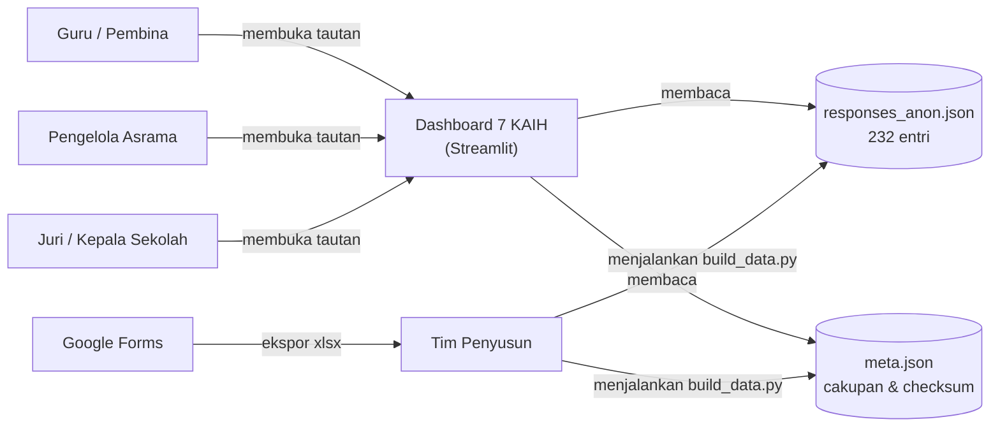
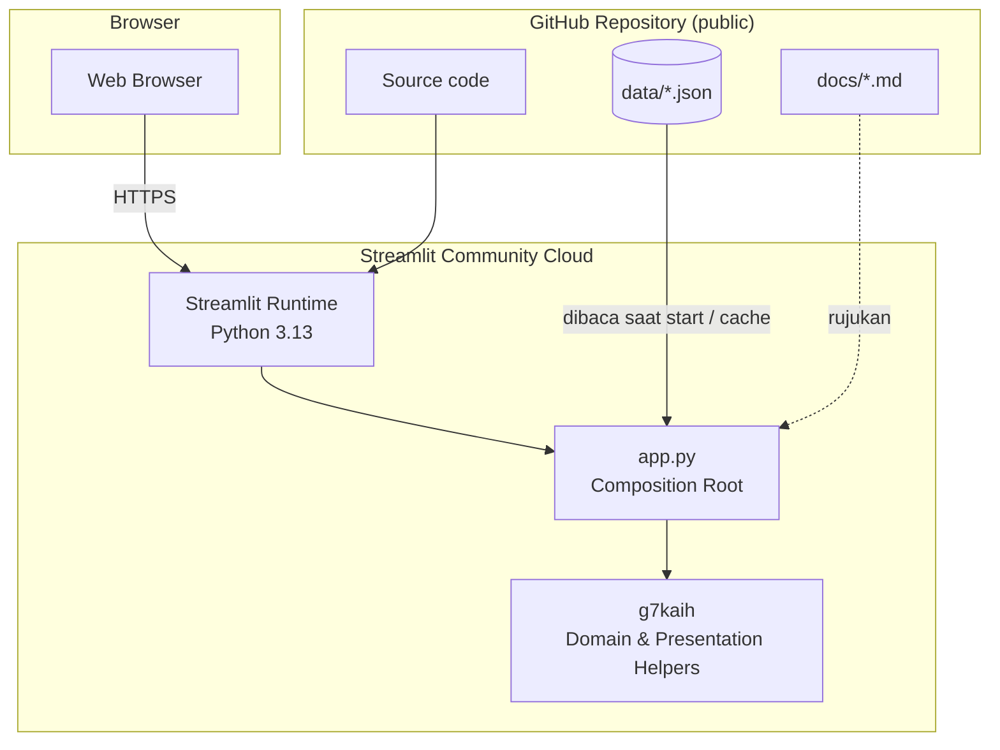
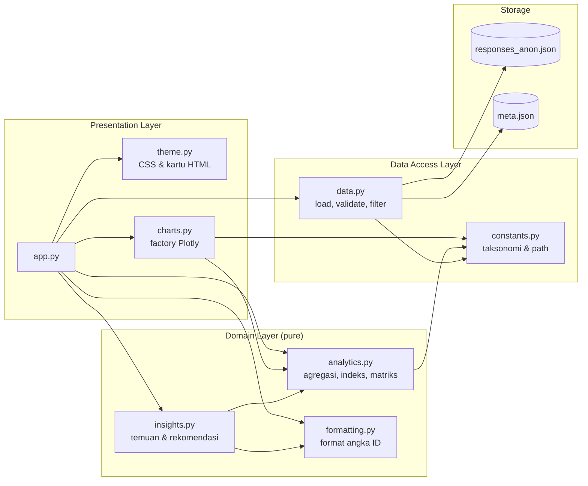
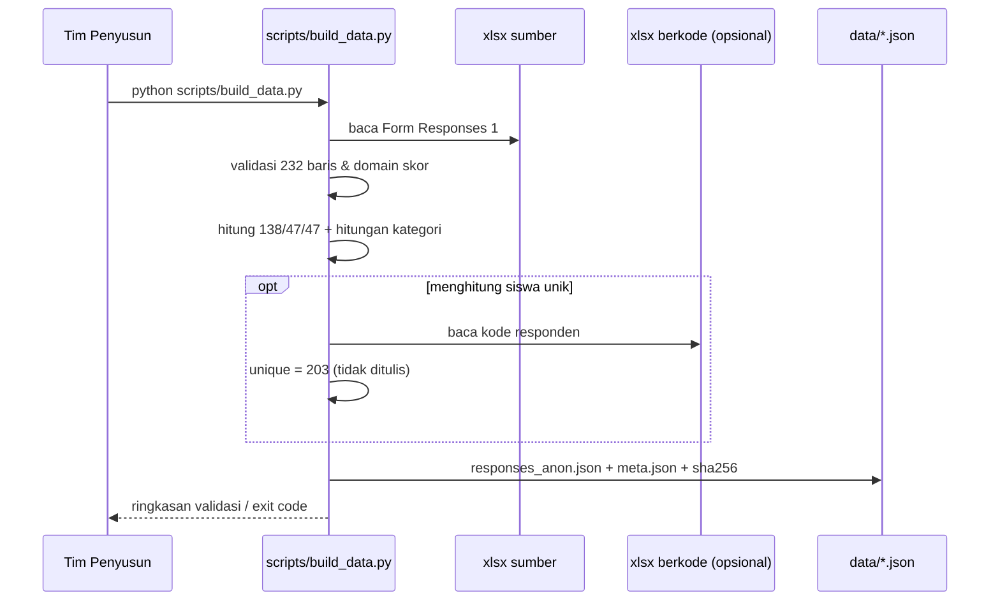
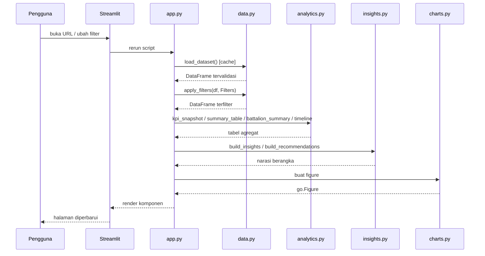
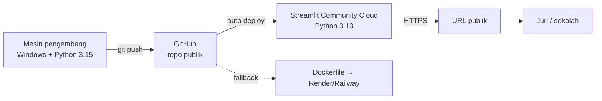

# ARCHITECTURE — Dashboard Pemantauan 7 KAIH

**Dokumen:** Software Architecture Document
**Versi:** 1.0 · **Tanggal:** 21 November 2026
**Rujukan:** [`PRD.md`](./PRD.md) · [`TSD.md`](./TSD.md)

---

## 1. Tujuan & Prinsip Arsitektur

Dokumen ini menjelaskan struktur sistem, aliran data, batas tanggung jawab antarlapisan, dan keputusan arsitektur beserta alasannya.

**Prinsip yang dianut**

1. **Single source of truth** — satu dataset anonim; semua angka diturunkan saat runtime.
2. **Pemisahan concerns** — analitik murni (pure) terpisah dari presentasi Streamlit.
3. **Determinisme** — fungsi agregasi tidak menyimpan state dan mudah diuji.
4. **Privacy by design** — data identitas tidak pernah masuk repositori/aplikasi.
5. **Deployability** — satu entry point, dependensi minimal, kompatibel hosting gratis.
6. **Transparansi** — rumus dan sumber tersedia di UI (tab Metodologi).

---

## 2. Konteks Sistem (C4 Level 1)

**Aktor eksternal:** pengguna read-only (tanpa autentikasi), Google Forms (sumber di luar sistem), GitHub (repositori), Streamlit Community Cloud (runtime).

---

## 3. Container (C4 Level 2)

| Container | Tanggung jawab | Teknologi |
|---|---|---|
| Browser | Merender UI, interaksi filter, unduh CSV | HTML/CSS/JS (dihasilkan Streamlit) |
| Streamlit Runtime | Siklus rerun, widget, session state | Streamlit 1.67 |
| `app.py` | Menyusun layout, memanggil domain, caching | Python |
| `g7kaih` | Taksonomi, loader, agregasi, insight, chart, tema | Python, pandas, Plotly |
| Repositori data | Data anonim + metadata | JSON |

---

## 4. Komponen (C4 Level 3)

**Aturan dependensi:** panah hanya mengarah ke lapisan yang lebih dalam. Domain tidak mengetahui Streamlit, file, atau UI. `charts.py` bergantung pada pandas/Plotly, bukan sebaliknya.

---

## 5. Alur Data

### 5.1 Alur Build (offline)

**Jaminan:** script gagal keras bila salah satu assertion tidak terpenuhi; tidak ada output parsial.

### 5.2 Alur Runtime (request pengguna)

---

## 6. Deployment

| Aspek | Keputusan |
|---|---|
| Artifact | Source Python + JSON data (tanpa build step) |
| Runtime | Streamlit Cloud, `runtime.txt` = `python-3.13` |
| Konfigurasi | `.streamlit/config.toml` (tema, headless, XSRF) |
| Rahasia | Tidak ada; aplikasi read-only |
| Rollback | Revert commit di GitHub → auto redeploy |
| Fallback | Docker image `python:3.13-slim` |

---

## 7. Keputusan Arsitektur (ADR)

### ADR-001 — Streamlit sebagai framework UI
- **Status:** Diterima
- **Konteks:** Tim Python, waktu terbatas, butuh tautan publik gratis, dashboard data-heavy.
- **Keputusan:** Streamlit + Plotly.
- **Alternatif:** Dash (lebih fleksibel, kurva belajar lebih tinggi), React+FastAPI (butuh dua stack).
- **Konsekuensi:** Pengembangan cepat dan deploy mudah; kustomisasi layout terbatas, dimitigasi dengan CSS dan HTML kustom.

### ADR-002 — JSON sebagai lapisan data, bukan xlsx langsung
- **Status:** Diterima
- **Konteks:** xlsx berisi data identitas pada varian lain dan mahal dibaca berulang.
- **Keputusan:** Build script menghasilkan JSON anonim tervalidasi; runtime hanya membaca JSON.
- **Konsekuensi:** Privasi terjaga, load cepat, skema eksplisit; perlu menjalankan ulang script bila data berubah.

### ADR-003 — Analitik murni tanpa Streamlit
- **Status:** Diterima
- **Konteks:** Logika yang bercampur UI sulit diuji dan rawan regresi.
- **Keputusan:** `analytics.py` dan `insights.py` hanya menerima/mengembalikan pandas/objek biasa.
- **Konsekuensi:** Unit test cepat, dapat dipakai ulang (CLI/notebook); butuh disiplin impor.

### ADR-004 — Tanpa autentikasi
- **Status:** Diterima
- **Konteks:** Data agregat anonim, tujuan publikasi lomba.
- **Keputusan:** Aplikasi read-only publik.
- **Konsekuensi:** Akses mudah bagi juri; tidak boleh ada data sensitif di UI.

### ADR-005 — Satuan analisis "entri"
- **Status:** Diterima
- **Konteks:** File utama tidak memiliki ID unik; beberapa siswa mengisi lebih dari sekali.
- **Keputusan:** Semua persentase dihitung per entri; jumlah siswa unik hanya ditampilkan sebagai metadata.
- **Konsekuensi:** Interpretasi jujur; menghindari klaim "232 siswa".

### ADR-006 — Golden test terhadap tabel referensi
- **Status:** Diterima
- **Konteks:** Kredibilitas dashboard bergantung pada kecocokan angka.
- **Keputusan:** Hard-code tabel referensi di test dan bandingkan seluruh agregat.
- **Konsekuensi:** Perubahan data yang tidak disengaja langsung terdeteksi.

---

## 8. Atribut Kualitas

| Atribut | Skenario | Respons Arsitektur |
|---|---|---|
| Akurasi | Data diperbarui | Build script ber-assert + golden test |
| Performa | 232 baris, filter berubah | Cache loader; agregasi in-memory O(n·7) |
| Ketersediaan | Cloud restart | Data statis di repo, tanpa DB |
| Privasi | Repo publik | Hanya JSON anonim; `.gitignore` untuk xlsx |
| Maintainability | Fitur baru | Lapisan domain terpisah, tipe, tes |
| Portabilitas | Python 3.13 vs 3.15 | API pandas/Plotly stabil, `runtime.txt` |
| Observability | Error runtime | `logging.exception`, pesan UI actionable |

---

## 9. Keamanan

- **Permukaan serangan:** hanya rendering read-only; tanpa form input yang disimpan.
- **XSS:** nilai dinamis pada HTML kustom di-escape.
- **Data leakage:** tidak ada NIS/nama di kode, data, log, maupun screenshot.
- **Supply chain:** dependensi dipin di `requirements.txt`; jumlah minimal.
- **Konfigurasi:** XSRF protection aktif (default Streamlit), CORS default.

---

## 10. Struktur & Batas Modul

| Modul | Boleh bergantung pada | Tidak boleh |
|---|---|---|
| `constants` | stdlib | semua modul internal |
| `formatting` | stdlib | pandas/streamlit |
| `data` | constants, pandas | streamlit, charts |
| `analytics` | constants, pandas | streamlit, data (I/O) |
| `insights` | analytics, formatting, constants | streamlit |
| `charts` | analytics (tipe), constants, plotly | streamlit |
| `theme` | streamlit (hanya CSS) | analytics |
| `app` | semua | — |

---

## 11. Ekstensibilitas

| Kebutuhan masa depan | Titik ekstensi |
|---|---|
| Tambah kebiasaan/pertanyaan | `constants.HABITS` + kolom JSON |
| Skala 5/7 titik | `SCALE_SCORES` + palet |
| Filter kelas/angkatan | `BATTALIONS` + `Filters` |
| Unduh PDF | mode laporan + `st.print` |
| Database | ganti `data.load_dataset` dengan adapter |
| Multi-sekolah | tambah dimensi `school` pada skema |

---

## 12. Risiko Arsitektural

| Risiko | Mitigasi |
|---|---|
| Ketergantungan pada Streamlit Cloud | Dockerfile fallback |
| Layout Streamlit kurang fleksibel | CSS kustom + komponen HTML |
| Rerun penuh setiap interaksi | Cache data; agregasi ringan |
| Data berubah tanpa build ulang | `meta.source_sha256` + peringatan di tab Metodologi |
